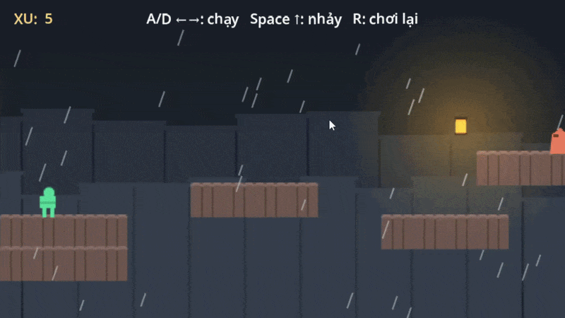

# Trên Mái Ngói — Demo game 2D platformer với Godot

Đây là một dự án nhỏ giúp bạn học Godot qua một trò chơi có thể chạy thử và chỉnh sửa ngay. Bạn sẽ chạy qua những mái nhà trong thành phố mưa, nhặt xu và tránh kẻ địch tuần tra.

Game sử dụng GDScript, gồm một màn chơi, cơ chế nhặt đồng xu, kẻ địch và điểm hồi sinh. Dự án còn có hoạt ảnh nhân vật, hiệu ứng âm thanh, nhạc nền và các hiệu ứng hình ảnh để bạn khám phá.

Đọc hướng dẫn chi tiết hơn và thực hành ngay tại [Aiducation](https://www.aiducation.edu.vn/console/kien-thuc/game-development/godot-102)

## Tải và chạy dự án

1. Tải toàn bộ mã nguồn dưới dạng ZIP rồi giải nén, hoặc clone kho mã nguồn.
2. Mở **Project Manager** của Godot, chọn **Import** và tìm đến file `project.godot`.
3. Mở dự án và đợi Godot nhập hình ảnh, âm thanh.
4. Nhấn **F5 / Run Project** để chơi thử.

**Phiên bản:** **Godot 4.7** với chế độ dựng hình **Compatibility**. Nên dùng phiên bản tương ứng với cấu hình dự án. Game dùng GDScript nên không cần bản .NET; hình ảnh và âm thanh đã có sẵn, không cần cài thêm plugin. Nếu chưa có, hãy tải phần mềm tại [trang tải Godot](https://godotengine.org/download/).

Scene chính là [`scenes/game.tscn`](scenes/game.tscn). Hãy dùng **Run Project** vì scene nhân vật cần các node trong scene chính để hoạt động. Những file có tên `web_*` vẫn thuộc game Godot này, không yêu cầu trình duyệt.

## Cách chơi

| Thao tác              | Phím                                   |
| --------------------- | -------------------------------------- |
| Di chuyển trái / phải | **A / D** hoặc **mũi tên trái / phải** |
| Nhảy                  | **Space** hoặc **mũi tên lên**         |
| Chơi lại toàn bộ màn  | **R**                                  |

Nhặt đủ xu để nhận thông báo hoàn thành trên HUD (phần hiển thị điểm và hướng dẫn). Chạm kẻ địch hoặc rơi xuống dưới màn chơi sẽ khiến nhân vật chết rồi hồi sinh. Chạm lá cờ để kích hoạt điểm hồi sinh mới.

Nhấn **R** sẽ đặt lại toàn bộ màn, bao gồm xu và điểm hồi sinh. Tiến độ chỉ được giữ trong lượt chơi hiện tại.

Bạn có thể đổi phím tại **Project → Project Settings → Input Map**. Các hành động di chuyển có tên `trai`, `phai`, `nhay`; hành động chơi lại là `khoi_dong_lai`.

## Cấu trúc dự án

Trong Godot, **node** là một thành phần đảm nhiệm chức năng cụ thể, như camera hoặc hình dạng va chạm. **Scene** tập hợp nhiều node thành một đối tượng có thể tái sử dụng. Màn chơi này sử dụng nhiều **instance** (bản thể) của cùng scene đồng xu và kẻ địch.

| File hoặc thư mục                                                                                     | Vai trò                                                                                                                               |
| ----------------------------------------------------------------------------------------------------- | ------------------------------------------------------------------------------------------------------------------------------------- |
| [`project.godot`](project.godot)                                                                      | Cấu hình scene chính, phím điều khiển, lớp va chạm, hiển thị và nhạc nền tự nạp.                                                      |
| [`scenes/game.tscn`](scenes/game.tscn) + [`scripts/web_game.gd`](scripts/web_game.gd)                 | Bố trí màn chơi, quản lý điểm, kết nối tín hiệu, hồi sinh và chơi lại.                                                                |
| [`scenes/web_player.tscn`](scenes/web_player.tscn) + [`scripts/web_player.gd`](scripts/web_player.gd) | Xử lý di chuyển, nhảy, hoạt ảnh và trạng thái chết của nhân vật.                                                                      |
| [`scenes/enemy.tscn`](scenes/enemy.tscn) + [`scripts/enemy.gd`](scripts/enemy.gd)                     | Kẻ địch tuần tra, phát hiện vật cản và khiến nhân vật chết khi chạm vào.                                                              |
| [`scenes/coin.tscn`](scenes/coin.tscn) / [`scenes/checkpoint.tscn`](scenes/checkpoint.tscn)           | Đồng xu và điểm hồi sinh, có script tương ứng trong `scripts/`.                                                                       |
| [`assets/`](assets/)                                                                                  | Hình ảnh, âm thanh và tài nguyên `.tres` như bộ ô bản đồ, hoạt ảnh. Tài nguyên mái nhà và nhân vật đang dùng nằm trong `assets/web/`. |

## Học qua những chỉnh sửa nhỏ

Mỗi lần chỉ nên thay đổi một chi tiết, lưu lại rồi chạy thử để thấy sự khác biệt.

1. **Điều chỉnh nhân vật.** Mở `scripts/web_player.gd`. Node `CharacterBody2D` dùng `_physics_process()` và `move_and_slide()` để xử lý chuyển động, va chạm. Thử đổi `RUN_SPEED` từ `165.0` thành `190.0`, sau đó chỉnh `JUMP_SPEED`. Game có **coyote time** (cho phép nhảy trong một khoảng ngắn sau khi rời mép mái) và **jump buffer** (ghi nhớ lần bấm nhảy ngay trước khi chạm đất).

2. **Chỉnh mái nhà.** Mở `scenes/game.tscn`, chọn node `VaCham` thuộc kiểu `TileMapLayer`. Dùng bộ ô có sẵn để vẽ thêm mái nhà trên lưới 24 × 24. Các ô đã có hình dạng va chạm cho mặt phẳng và dốc. Thêm một đoạn mái ngắn rồi thử nhảy tới đó. Bật **Debug → Visible Collision Shapes** khi chạy để quan sát vùng va chạm.

3. **Tìm hiểu tín hiệu.** **Signal** (tín hiệu) giúp node thông báo sự kiện cho node khác. Trong `scripts/coin.gd`, `Area2D` phát hiện người chơi rồi phát tín hiệu `collected`; `web_game.gd` nhận tín hiệu và tăng điểm. Nhân đôi một đồng xu trong `Game/Coins`, đổi vị trí rồi chạy lại: game tự đếm và kết nối các đồng xu này. Điểm hồi sinh cũng hoạt động theo cách tương tự với tín hiệu `activated`.

4. **Điều chỉnh kẻ địch.** Chọn một kẻ địch trong `Game/Enemies`, đổi `speed` hoặc `patrol_radius` ở bảng **Inspector**. Các biến xuất hiện tại đây nhờ khai báo `@export` trong `enemy.gd`. Hai node `RayCast2D` dò mép mái và tường để kẻ địch biết lúc quay đầu. Đồng xu, điểm hồi sinh và vùng nguy hiểm của kẻ địch nhận diện người chơi qua lớp va chạm và nhóm `nguoi_choi`.

5. **Khám phá hình ảnh và âm thanh.** Xem `NhanVat/Camera2D` để tìm hiểu chuyển động camera mượt và giới hạn màn hình. Các node `Parallax2D` tạo chiều sâu bằng cách cho nền cuộn với tốc độ khác nhau. Hoạt ảnh, bụi và vệt chuyển động giúp hành động dễ nhận biết hơn. `scripts/rain.gd` vẽ mưa; `scripts/music.gd` là **autoload**, một node luôn được nạp để nhạc tiếp tục phát khi chơi lại màn.

Tài nguyên học thêm: [Hướng dẫn làm game 2D đầu tiên của Godot](https://docs.godotengine.org/en/stable/getting_started/first_2d_game/index.html)

## Tự khám phá thêm!

- **Thêm kẻ địch:** Nhân đôi các instance trong `Game/Enemies`, thay đổi tốc độ và phạm vi tuần tra. Sau đó thử tạo kẻ địch bay hoặc đuổi theo người chơi. Nếu loại mới có cách quản lý trạng thái khác, hãy cập nhật `respawn_player()`: phần đặt lại hiện dùng các biến `origin`, `velocity` và `direction`.
- **Mở rộng bản đồ:** Vẽ thêm mái nhà, tăng `map_width` của node `Game` (hiện là `2064`) và tăng `NhanVat/Camera2D.limit_right`. Mở rộng nền trời, vùng mưa, rồi dời biển kết thúc và đặt thêm xu. Nếu mở rộng xuống dưới, cần chỉnh cả giới hạn dọc của camera và ngưỡng rơi chết trong script nhân vật (`position.y > 270`).
- **Thêm điểm hồi sinh:** Đặt thêm các instance của scene checkpoint và kết nối tín hiệu `activated` của từng điểm tới `_on_checkpoint()` trong `web_game.gd`. Hiện game chỉ kết nối node có tên `Checkpoint`.
- **Thêm đích đến và màn chơi:** Đặt một `Area2D` ở mái cuối để hiện màn hình chiến thắng hoặc chuyển màn. Biển kết thúc hiện tại chỉ là nhãn chữ; nhặt đủ xu mới làm đổi thông báo trên HUD.
- **Thêm cơ chế và giao diện:** Thử làm nhảy hai lần, bệ di chuyển hoặc menu tạm dừng. Bạn cũng có thể thêm phím tay cầm trong **Input Map** rồi kiểm tra bằng cách chơi hết màn.

Hãy bắt đầu với một đoạn mái, một đồng xu và một kẻ địch mới. Chơi thử khu vực vừa sửa, kiểm tra hồi sinh và chơi lại, rồi xem bảng **Debugger** có báo lỗi không trước khi tiếp tục mở rộng.
